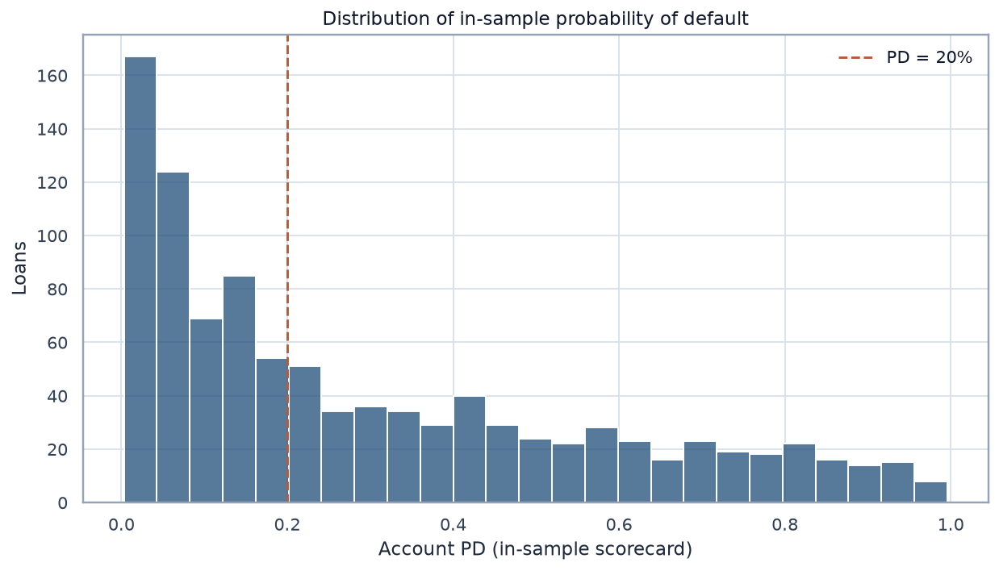
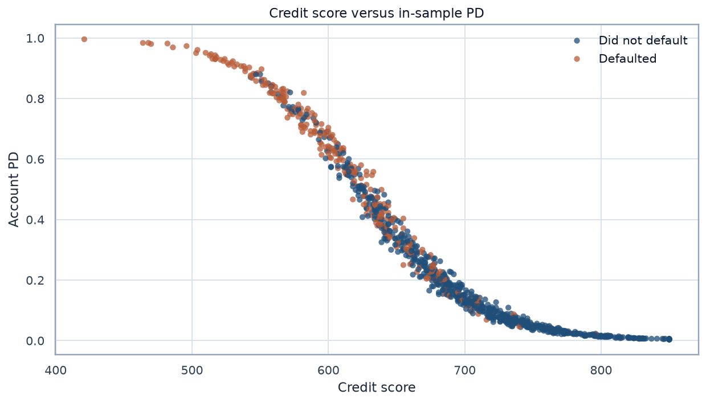
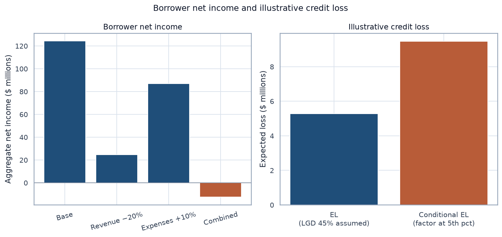
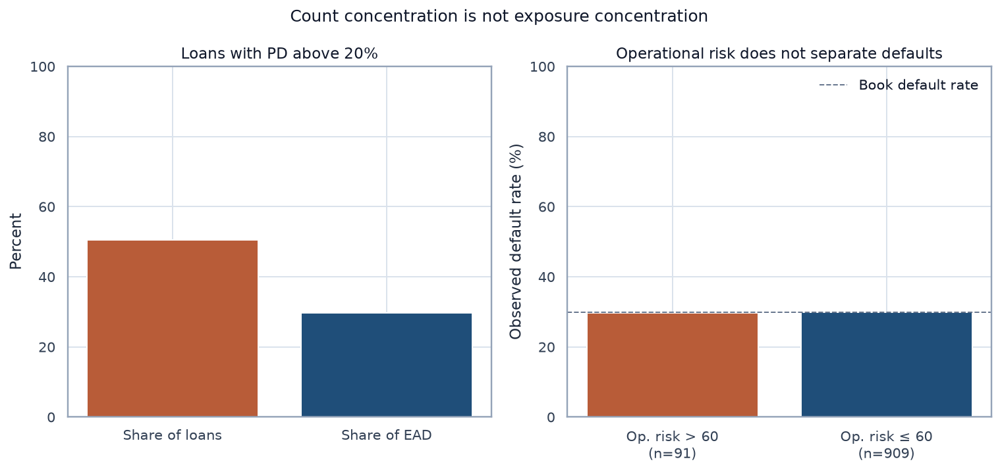

# Portfolio credit risk

A case study on a synthetic book of 1,000 loans in [portfolio_data.csv](portfolio_data.csv). Running `python -m credit_risk` rewrites [REPORT.md](REPORT.md) and the charts under `Screenshot/` from that file.

## Run

Pinned dependencies are in [requirements.txt](requirements.txt). Tests run in GitHub Actions.

```bash
python -m venv .venv
source .venv/bin/activate
python -m pip install -r requirements.txt
python -m pytest -q
python -m credit_risk
```

`python -m credit_risk.generate --seed 42 --output synthetic_portfolio.csv` draws a separate book from a fixed scorecard. It does not recreate `portfolio_data.csv`. That checked-in file has no saved seed, and `PD_Score` there is the full-sample fit. The synthetic file is gitignored.

## Definitions

- **PD** is an account probability of default: the `PD_Score` column, an in-sample logistic fit on credit score, loan amount, and operational risk. It is not a holdout score. Out-of-fold AUC is 0.852 (DeLong 95% CI 0.828 to 0.877). Gini is 0.705. KS is 0.546 (bootstrap 95% CI 0.505 to 0.612).
- **EAD** is outstanding loan amount.
- **LGD** is not in the file. Dollar losses use a constant 45%.
- **Expected loss** is PD × LGD × EAD.
- **Credit-loss VaR** is a quantile of simulated portfolio loss (one-factor Gaussian copula, asset correlation 0.15, 20,000 draws, seed 42). The copula has no tail dependence, and LGD does not worsen in the tail. A bootstrap of those draws (1,000 samples, seed 42) puts the 95% VaR between $9,436,973.61 and $9,622,340.47, and the 99% VaR between $11,768,211.11 and $12,085,866.62. The cents in the table are the seeded point estimate. The bands are Monte Carlo error.

## Results

| | |
|---|---:|
| Loans | 1,000 |
| Total EAD | $68,121,079.07 |
| Unweighted mean PD | 29.80% |
| EAD-weighted mean PD | 17.23% |
| PD above 20% | 504 loans: 50.4% of count, 29.72% of EAD |
| Sum of PD × EAD (before LGD) | $11,734,442.82 |
| Expected loss (LGD 45%) | $5,280,499.32 |
| 95% / 99% credit-loss VaR | $9,526,628.91 / $11,936,201.30 |
| Combined earnings stress | -$12,559,240.00 of aggregate borrower net income |

The earnings figure is revenue down 20% and expenses up 10%. It does not change PD or expected loss.

The draft called $43,146.55 and $25,890.70 a 95% and 99% VaR. Those are the 5th and 1st percentiles of per-account borrower net income.

Higher-PD loans are smaller, which is why the unweighted PD sits above the exposure-weighted PD. Credit score is the variable associated with PD (correlation -0.94). Loan amount moves with credit score (correlation 0.92). A credit-score-only logit has out-of-fold AUC 0.853. The three-feature model does not improve on it (DeLong 95% CI on the difference, -0.0036 to 0.0026, includes zero).

Shapley values on the probability scale use the average feature vector as the reference, where PD is 20.61%. Mean absolute attributions are 0.240 for credit score, 0.023 for loan amount, and 0.015 for operational risk.

There is no origination date, so the five-fold split is not out-of-time. The model is not class-weighted. Out-of-fold calibration slope is 0.974. Brier skill versus the base rate is 0.339. Adding revenue, expenses, and net income, standardized inside each training fold, gives out-of-fold AUC 0.8522 versus 0.8524. They are not a measured leak. They stay out of the scorecard because they are not application features here.

Operational risk above 60 does not mark a higher default rate: 27 of 91 loans (29.67%) versus 271 of 909 (29.81%).

## Charts

### Default-probability distribution



### Credit score versus PD



### Earnings and credit loss



### Concentration



## Files

| File | What it is |
|---|---|
| [REPORT.md](REPORT.md) | Note written by the code |
| [Risk_Assessment_Report.docx](Risk_Assessment_Report.docx) | Same figures, in the memo |
| [portfolio_data.csv](portfolio_data.csv) | The 1,000-loan book |
| [Screenshot/](Screenshot/) | Charts from `python -m credit_risk` |

The book is synthetic. LGD and asset correlation are assumptions. This is not lending or investment advice. Anything in the memo that reads as a recommendation is judgment; the file does not measure its effect.
